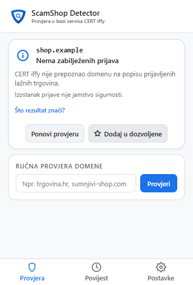
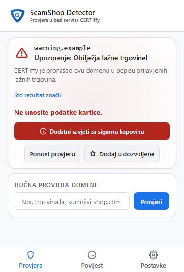
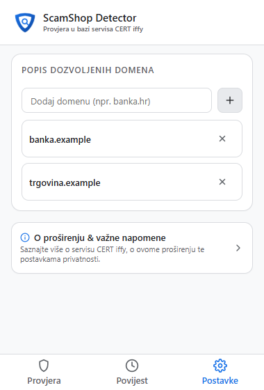

<p align="center">
  
</p>

<h1 align="center">ScamShop Detector</h1>

<p align="center">
  Provjerite internetsku trgovinu u bazi CERT iffy prije kupnje — na vaš zahtjev.
</p>

<p align="center">
  <a href="https://github.com/mgracanin/scamshop-detector/releases/latest"></a>
  <a href="https://github.com/mgracanin/scamshop-detector/actions/workflows/ci.yml"></a>
  <a href="LICENSE"></a>
</p>

<p align="center">
  <a href="https://github.com/mgracanin/scamshop-detector/releases/latest"><strong>⬇️ Preuzmi najnoviju verziju</strong></a>
  · <a href="https://github.com/mgracanin/scamshop-detector/releases">Sva izdanja</a>
</p>

> **Neovisni projekt:** ScamShop Detector nije razvio niti ga održava CARNET ili Nacionalni CERT. Koristi javno dostupan servis [CERT iffy](https://iffy.cert.hr/). Rezultat bez upozorenja ne jamči da je trgovina sigurna.

## Pregled

Provjerite otvorenu stranicu klikom na ikonu proširenja. Možete provjeriti i adresu koju ste unijeli ili poveznicu prije nego što je otvorite. ScamShop Detector uspoređuje domenu s postojećim podacima servisa CERT iffy; ne analizira trgovinu u stvarnom vremenu.

| Provjera otvorene stranice | Upozorenje | Vaš popis dozvoljenih domena |
| --- | --- | --- |
|  |  |  |

*Domene prikazane na snimkama zaslona služe kao ilustrativni primjeri sučelja.*

## Mogućnosti

- **Provjera na zahtjev:** provjerite trenutačnu stranicu klikom na ikonu, unesite domenu u skočnom prozoru ili zatražite provjeru stranice odnosno poveznice iz kontekstnog izbornika.
- **Dozvoljene domene:** dodajte poznate domene na svoj popis. Odgovarajuće poddomene nasljeđuju dozvolu.
- **Povijest provjera:** pregledajte lokalnu povijest grupiranu po datumima, pratite osnovnu statistiku i vratite nedavno uklonjen zapis.
- **Predmemorija:** rezultat se čuva do 10 minuta radi izbjegavanja ponovljenih upita.

## Značenje oznaka

| Oznaka | Značenje |
| --- | --- |
| `OK` | Domena nije pronađena među prijavljenim lažnim trgovinama u bazi CERT iffy. To nije jamstvo sigurnosti. |
| `WRN` | Domena je zabilježena u bazi CERT iffy kao lažna trgovina. Izbjegavajte unos osobnih i kartičnih podataka. |
| `WHT` | Domena je na vašem popisu dozvoljenih; provjera servisa se za nju preskače. |
| `ERR` | Provjeru nije bilo moguće dovršiti, primjerice zbog neispravne adrese ili nedostupnog servisa. |

## Instalacija

1. Otvorite [najnovije izdanje](https://github.com/mgracanin/scamshop-detector/releases/latest), preuzmite ZIP arhivu i raspakirajte je u mapu.
2. U Chromeu otvorite `chrome://extensions`.
3. Uključite **Developer mode**.
4. Kliknite **Load unpacked** i odaberite raspakiranu mapu koja sadrži `manifest.json`.

**Ažuriranje:** zamijenite datoteke u postojećoj mapi proširenja i pritisnite gumb za ponovno učitavanje na `chrome://extensions`. Nemojte uklanjati proširenje ako želite zadržati njegovu lokalnu povijest i popis dozvoljenih domena.

## Privatnost

- Zahtjev prema CERT iffy šalje samo normaliziranu domenu, bez putanje stranice i upitnih parametara. Provjera se pokreće na vaš zahtjev.
- Za uspostavu sesije s iffy.cert.hr preglednik koristi standardne kolačiće te domene. Proširenje ne čita kolačiće drugih stranica.
- Popis dozvoljenih domena, povijest i statistika pohranjuju se lokalno u pregledniku. Proširenje ne koristi analitiku ni vanjsko praćenje.

## Razvoj

Potreban je Node.js 22.13 ili noviji; preporučuje se Node.js 24.

```bash
npm ci
npm run install:browser
npm run build
npm run verify
```

`npm run build` stvara `dist/extension/` i verzionirani ZIP. `npm run verify` pokreće lint, provjere formatiranja i manifesta te jedinične i pregledničke testove nad pakiranom verzijom. CI sprema provjereni ZIP kao artefakt; objavljena izdanja nalaze se na stranici [GitHub Releases](https://github.com/mgracanin/scamshop-detector/releases).

```text
background/  CERT upiti, stanje i integracija s preglednikom
shared/      zajedničke funkcije
popup/       skočni prozor i stranica s informacijama
icons/       ikone proširenja
tests/       jedinični i preglednički testovi
scripts/     provjera, testiranje i pakiranje
```

## Pomoć i licenca

Prijavite poteškoću ili prijedlog na [GitHub Issues](https://github.com/mgracanin/scamshop-detector/issues). ScamShop Detector objavljen je pod licencom [MIT](LICENSE). Autor i održavatelj: [Matija Gračanin](mailto:matijag@gmail.com). Izvor podataka: [CERT iffy](https://iffy.cert.hr/), servis Nacionalnog CERT-a pri CARNET-u.
